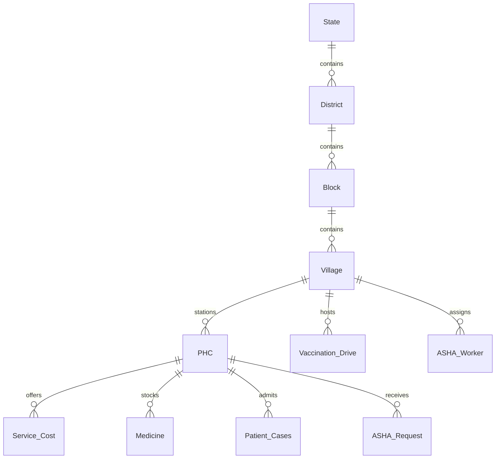

# Rural Care Connect: System Architecture

**Project Tagline:** *"Healthcare access for every village."*  
**SDG Alignment:** SDG 3 (Good Health and Well-Being), SDG 9 (Industry, Innovation, and Infrastructure), SDG 10 (Reduced Inequalities)

---

## 1. Architectural Overview

Rural Care Connect is structured as a 3-tier web application designed specifically for low-resource and rural contexts in India:

```
+-----------------------------------------------------------------------------------+
|                                 CLIENT TIER                                       |
|  +------------------------+  +--------------------------+  +-------------------+  |
|  | Public Citizen Portal  |  |   ASHA Field Portal      |  | Admin Management  |  |
|  | - Nearest PHC Map      |  | - Village Caseload       |  | - Full CRUD       |  |
|  | - Budget Care Finder   |  | - Immediate Admission    |  | - Audit Trail     |  |
|  | - Village Camp Finder  |  | - Emergency 108 Alert    |  | - Outbreak Alerts |  |
|  | - Rule Symptom Checker |  | - Low Stock Indicator   |  | - Surveillance    |  |
|  +------------------------+  +--------------------------+  +-------------------+  |
|           |                               |                          |            |
|     [i18n Translation Engine]      [Low-Bandwidth CSS Switcher]     [Leaflet Maps]|
+-----------------------------------------------------------------------------------+
                                         |
                                (REST API / HTTPS)
                                         |
+-----------------------------------------------------------------------------------+
|                              APPLICATION TIER                                     |
|  Express.js Server (Node.js) on Port 3000                                         |
|  - Middleware: Session State, CORS, Error Handling, Role Guards (Admin / ASHA)   |
|  - Core Modules:                                                                 |
|    * /api/phcs                * /api/geography         * /api/services            |
|    * /api/vaccination-drives  * /api/asha              * /api/cases               |
|    * /api/diseases            * /api/medicines         * /api/alerts              |
|    * /api/stats (EpiClim)     * /api/weather           * /api/reports             |
+-----------------------------------------------------------------------------------+
                                         |
                           (mysql2 / Connection Pool)
                                         |
+-----------------------------------------------------------------------------------+
|                                 DATABASE TIER                                     |
|  MySQL 8.0 Relational Engine                                                      |
|  +-----------------------------------------------------------------------------+  |
|  | Normalized 3NF Hierarchy: State > District > Block > Village > PHC          |  |
|  | Primary Tables: PHC, Service_Cost, Vaccination_Drive, ASHA_Worker, Requests |  |
|  | Preserved Epidemiology: Disease_Stats (8,974 records intact)                |  |
|  | Stored Procedures: sp_nearest_phc (Haversine), sp_admit_patient, close_case  |  |
|  | Triggers: trg_vaccine_drive_stockout, trg_case_alert, audit triggers        |  |
|  | Views: vw_bed_availability, v_affordable_services, vw_upcoming_drives, etc. |  |
|  +-----------------------------------------------------------------------------+  |
+-----------------------------------------------------------------------------------+
```

---

## 2. Geographic & Healthcare Hierarchy (3NF)

To eliminate redundancies and reflect India's administrative reality, geographic entities are normalized to Third Normal Form (3NF):



1. **State:** State administrative unit (Maharashtra, Madhya Pradesh, Bihar).
2. **District:** Administrative district with geographic coordinates.
3. **Block (Taluka/Tehsil):** Sub-district unit managing rural healthcare delivery.
4. **Village:** Grassroots population center with census count and GPS coordinates.
5. **PHC (Primary Health Centre):** Frontline rural health facility (PHC, CHC, Sub-centre, District Hospital) with beds, doctors on duty, and ambulance stations.

---

## 3. Frontend Subsystems

### 3.1 Trilingual Localization (`i18n.js`)
- Client-side dictionary engine storing translations in `frontend/locales/en.json`, `hi.json`, `mr.json`.
- Dynamic element translation using `data-i18n` attributes.
- Preserves selected language across visits via `localStorage.getItem('rcc_lang')`.

### 3.2 Low-Bandwidth Mode (`style.css`)
- Designed for rural 2G/3G connectivity.
- Toggles `.low-bandwidth` class on `<body>`:
  - Disables CSS animations, drop shadows, and gradients.
  - Replaces custom iconography with native monospace markers.
  - Hides non-essential decorative elements to save memory and CPU cycles.

### 3.3 Rule-Based Rural Clinical Symptom Checker
- Runs entirely client-side without external cloud dependencies.
- Analyzes reported symptoms against deterministic clinical rule sets:
  - High fever + chills + body ache &rarr; Malaria / Dengue alert.
  - Watery diarrhea + vomiting + dehydration &rarr; Cholera / Gastroenteritis alert.
  - Puncture wound + swelling &rarr; Snakebite emergency protocol (immediate anti-snake venom referral).
  - Animal bite &rarr; Rabies post-exposure prophylaxis warning.

---

## 4. Backend Route Map

| Route Prefix | Controller / Handler | Purpose |
|---|---|---|
| `/api/auth` or `/api` | `routes/auth.js` | Login, logout, session verification, role redirection |
| `/api/phcs` | `routes/phcs.js` | PHC CRUD, bed capacity, Haversine nearest search (`sp_nearest_phc`) |
| `/api/hospitals` | `routes/hospitals.js` | Backwards-compatibility alias pointing directly to `routes/phcs.js` |
| `/api/geography` | `routes/geography.js` | Hierarchy drill-down (`/tree`, `/states`, `/districts`, `/blocks`, `/villages`) |
| `/api/services` | `routes/services.js` | Affordable care catalog & budget filtering (`/affordable`, `/budget`) |
| `/api/vaccination-drives` | `routes/vaccination_drives.js` | Village immunization camp scheduling and tracking (`/upcoming`) |
| `/api/asha` | `routes/asha.js` | ASHA profile, village dashboard, patient admission, emergency requests |
| `/api/cases` | `routes/cases.js` | Patient clinical admissions via `sp_admit_patient` and `sp_close_case` |
| `/api/alerts` | `routes/alerts.js` | Outbreak warnings with geographic targeting (`area_level`, `area_name`) |
| `/api/medicines` | `routes/medicines.js` | Pharmacy stocks and low-stock view `vw_low_stock` |
| `/api/stats` | `routes/stats.js` | Live KPI metrics and historical EpiClim dataset (8,974 records) |

---

## 5. Security & Session Management
- **Password Protection:** Passwords securely hashed with bcrypt (10 rounds).
- **Session Store:** Server-side sessions using `express-session` with HTTP-only cookies.
- **SQL Injection Prevention:** 100% of queries use MySQL2 prepared statements with parameter binding.
- **RBAC (Role-Based Access Control):** Custom route guards:
  - `requireLogin`: Verified authenticated session.
  - `requireAdmin`: Administrator privileges only.
  - `requireAsha`: ASHA worker privileges only.
  - `requireAdminOrAsha`: Either Administrator or ASHA worker.
